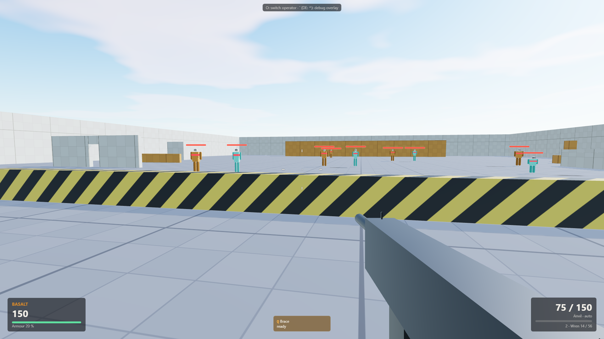

# Counterweight — operator-based tactical FPS (Phase 1 prototype)

*Working title.* An original, round-based, tactical first-person shooter for the browser, built
around **operators** with distinct kits and a distinct place on the **speed ↔ power**
spectrum: slow, armoured anchors at one end, very fast and fragile flankers at the other.
Every strength costs something.

This folder contains **Phase 0 (design documents)** and **Phase 1 (technical foundation)**: a
playable tech prototype on a greybox test range that proves the core architecture. It is not the
game yet — see the [roadmap](docs/ROADMAP.md).



## What the prototype shows

- Greybox test range: shooting lanes at several distances, strafing dummies, a movement course
  (stairs, ramp, crouch tunnel, jump boxes), peek walls. Directional sun with shadows,
  procedural sky with matching image-based light, 1 m-grid dev textures.
- First-person controller: pointer lock with raw input where supported, WASD, sprint, crouch
  (with head-room check), jump; fixed-tick simulation with render interpolation; Rapier
  kinematic character controller.
- Hitscan gunplay: fire rate, spread cone (dynamic crosshair), deterministic recoil pattern,
  ammo and reload, ADS zoom, hit markers, damage numbers, dummy health bars, impact marks,
  headshots through a separate head hitbox.
- Two operators from `src/data/` — **Basalt** (anchor: armoured, heavy LMG, slow, *Brace*) and
  **Wisp** (speedster: fragile, SMG, very fast, *Slipstream* dash) — switchable in game. Their
  numbers: [docs/generated/ROSTER.md](docs/generated/ROSTER.md).
- Debug overlay: FPS, tick rate, player kinematics, raw operator/weapon data plus effective
  top speed and current spread.
- `npm run balance`: power budget per operator + time-to-kill matrix for the full design
  roster.

## Run

Requires Node 24+ and npm 11+.

```bash
npm install                 # once
npm run dev                 # dev server (prints the local URL; port in tools/lib/deploy.ts)
npm run build               # type-check + production build into dist/ (relative paths)
npm run preview             # serve the production build
```

Opening `index.html` directly from disk does not work (`file://`); use the dev server.

The page opens **Relay** (attack/defence with operator select and the uplink, you and bots
against bots on Saltworks — [SPEC §4.1](docs/SPEC.md)); the menu (Esc) switches to
Elimination or the Range, and the URL takes `?mode=elimination`, `?mode=range`, `&level=`,
`&tier=` and `&seed=` (defaults: `LAUNCH` in `src/config/client.ts`).

## Test and tools

```bash
npm test                    # Vitest: damage/TTK, resources, spread/recoil, content, budget, sim (Rapier in Node)
npm run lint                # ESLint incl. the simulation boundary rule (ADR-0003)
npm run test:e2e            # production build + Playwright smoke test (served from a sub-directory)
npm run check               # lint + typecheck + unit + e2e
npm run balance             # power budget + TTK matrix from src/data (exit 1 if out of band)
npm run docs:gen            # regenerate docs/generated/*.md and the controls table below
npm run shots               # screenshots from named camera positions → docs/screenshots/
```

Playwright uses the Chromium build in the shared Playwright cache (pinned to 1.62.1; on a fresh
machine run `npx playwright install chromium` once).

## Controls

<!-- GENERATED:controls -->
| Input | Action |
| --- | --- |
| W | Move forward |
| S | Move back |
| A | Strafe left |
| D | Strafe right |
| Shift | Sprint (forward only) |
| C | Crouch (hold) |
| Space | Jump |
| Left mouse | Fire |
| Right mouse | Aim down sights (hold) |
| R | Reload |
| 1 | Primary weapon |
| 2 | Secondary weapon |
| Mouse wheel | Swap to the other weapon |
| Q | Ability 1 (hold to channel; while placing: fire places, aim or the key again cancels) |
| E | Ability 2 (hold to channel; while placing: fire places, aim or the key again cancels) |
| F | Interact (hold): plant or disrupt the uplink (Relay) |
| O | Switch operator (range; elimination and Relay: before the round starts) |
| ` (DE: ^) | Toggle debug overlay |
| Esc | Release the mouse / open the menu |
<!-- /GENERATED:controls -->

Settings (FOV, sensitivity, ADS sensitivity, volume, raw input, damage numbers) are in the menu
(Esc) and persist in the browser.

## Folder overview

```
index.html            app shell + UI style tokens
src/main.ts           boot (loading screen, lazy-loads the game)
src/config/           sim.ts (global rules: tick, physics, movement feel) · client.ts (render, input, HUD, audio, shots)
src/data/             SSOT for every balance number: operators, weapons, abilities, hitboxes, budget, levels
src/sim/              fixed-tick simulation (no Three.js/DOM): systems, combat maths, abilities, Rapier physics
src/ai/               bot brains → the same Command type players produce
src/balance/          TTK matrix and power-budget model (used by npm run balance and tests)
src/client/           Three.js rendering, DOM UI, Web Audio, input, QA hooks
tests/unit/           Vitest suites        tests/e2e/   Playwright smoke test
tools/                balance.ts, gen-docs.ts, screenshot.mjs, serve-dist.ts
docs/                 design and architecture docs (below)
```

## Documentation

- [docs/SPEC.md](docs/SPEC.md) — game design spec (pillars, modes, operator/weapon/ability model, roster, feel, bots, maps, HUD, audio, out of scope)
- [docs/ARCHITECTURE.md](docs/ARCHITECTURE.md) — layers, data flow, state ownership, testing
- [docs/NETWORKING.md](docs/NETWORKING.md) — plan for online play (authoritative server, prediction, lag compensation)
- [docs/ROADMAP.md](docs/ROADMAP.md) — milestones M1–M6 with definitions of done
- [docs/decisions/](docs/decisions/) — architecture decision records
- [docs/generated/ROSTER.md](docs/generated/ROSTER.md) · [docs/generated/BALANCE.md](docs/generated/BALANCE.md) — generated from `src/data/`
- [docs/ASSET_MANIFEST.md](docs/ASSET_MANIFEST.md) — external assets and licences
- [docs/PROJECT_STATE.md](docs/PROJECT_STATE.md) — dated progress log and handover notes
- [CLAUDE.md](CLAUDE.md) — project rules for contributors and coding agents

## Deployment

`npm run build` produces a static `dist/` with relative paths (`base: './'`); Rapier's WASM is
inlined, so the folder works from any sub-directory of the GitHub Pages site. Nothing is
committed or deployed automatically.
